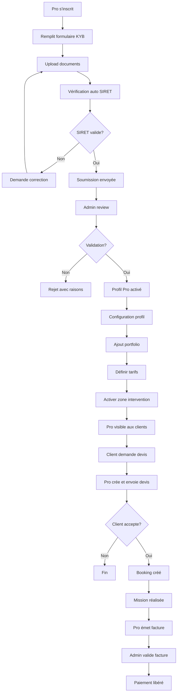

# 🏢 ImuPro - Phase 1 : Infrastructure & Types

**Date**: 20 octobre 2025  
**Phase**: Phase 1 - Fondations techniques  
**Statut**: ✅ Types créés - En cours d'intégration

---

## 📦 Fichiers Créés

### 1. Types KYB (`functions/src/types/kyb.ts`)

**Contenu** : Extension du système KYC pour les professionnels

- ✅ `KYBDocumentType` : 10 types de documents (SIRET, RC Pro, diplômes, casier judiciaire...)
- ✅ `BusinessType` : 6 formes juridiques (auto-entrepreneur, SARL, SAS...)
- ✅ `ProServiceCategory` : 10 catégories de services pros
- ✅ `Certification` : Structure pour diplômes et certifications
- ✅ `BusinessInfo` : Informations commerciales complètes
- ✅ `ProfessionalInsurance` : Gestion RC Pro avec alertes expiration
- ✅ `KYBDocument` : Document avec date d'expiration
- ✅ `KYBSubmission` : Soumission complète avec vérifications auto
- ✅ `ProVerificationStatus` : 6 statuts de vérification

**Lignes** : 180 lignes

---

### 2. Types Profil Pro (`functions/src/types/pro-profile.ts`)

**Contenu** : Profils enrichis pour professionnels

- ✅ `PortfolioItem` : Éléments du portfolio (5 photos max)
- ✅ `ProBadges` : 6 badges de confiance
- ✅ `PricingType` : 3 modes de tarification (fixe, horaire, devis)
- ✅ `FixedPrice` : Prix par type de service
- ✅ `PricingModel` : Modèle complet avec TVA
- ✅ `WorkingHours` : Planning hebdomadaire
- ✅ `ServiceArea` : Zone d'intervention géographique
- ✅ `TravelFee` : Frais de déplacement
- ✅ `ProStats` : Statistiques du professionnel
- ✅ `ProProfile` : Profil complet (30+ propriétés)
- ✅ `PublicProProfile` : Vue publique pour clients
- ✅ `ProSearchCriteria` : Filtres de recherche

**Lignes** : 280 lignes

---

### 3. Types Devis & Facturation (`functions/src/types/quote-invoice.ts`)

**Contenu** : Système de devis et facturation légale

- ✅ `QuoteStatus` : 7 statuts de devis
- ✅ `QuoteLineItem` : Ligne de devis détaillée
- ✅ `PaymentTerms` : 6 conditions de paiement
- ✅ `QuoteRequest` : Demande de devis client
- ✅ `Quote` : Devis complet avec validité
- ✅ `QuoteTemplate` : Templates réutilisables
- ✅ `InvoiceStatus` : 7 statuts de facture
- ✅ `Invoice` : Facture conforme (émetteur, acheteur, TVA, commission)
- ✅ `QuoteWorkflow` : 8 étapes du processus
- ✅ `QuoteWorkflowEvent` : Événements tracés
- ✅ `InvoicingStats` : Statistiques de facturation

**Lignes** : 260 lignes

---

### 4. Export centralisé (`functions/src/types/imupro.ts`)

Point d'entrée unique pour tous les types ImuPro.

```typescript
export * from "./kyb";
export * from "./pro-profile";
export * from "./quote-invoice";
```

---

## 🎯 Prochaines Étapes

### Tâche 2 : Extension système KYC → KYB

**Objectif** : Créer les Cloud Functions pour la validation KYB

#### 2.1 Cloud Functions KYB

Créer `/functions/src/kyb/kyb-validation.ts` :

- `submitKYB` : Soumission documents pro (SIRET, RC Pro, certifications)
- `verifyKYB` : Vérification auto SIRET (API INSEE)
- `approveKYB` : Validation admin avec attribution profil Pro
- `rejectKYB` : Rejet avec raisons
- `listKYBSubmissions` : Liste pour admin
- `checkInsuranceExpiry` : Job quotidien pour alertes RC Pro

#### 2.2 API INSEE Integration

- Fonction de vérification SIRET en temps réel
- Cache des résultats (24h)
- Gestion des erreurs API

#### 2.3 Storage Rules

Extension des règles pour documents KYB :

```
/kyb/{userId}/{documentType}_{timestamp}.{ext}
```

Permissions :
- Upload : utilisateur authentifié (son propre dossier)
- Lecture : utilisateur + admins
- Suppression : admins uniquement

---

### Tâche 4 : Profil Pro V1 - UI/UX

**Objectif** : Interfaces utilisateur pour les professionnels

#### 4.1 Page Inscription Pro

`/dashboard/become-pro/page.tsx` :

- Formulaire KYB complet
- Upload multiples documents avec preview
- Barre de progression (8 étapes)
- Validation temps réel des champs
- Preview du profil avant soumission

#### 4.2 Dashboard Pro

`/dashboard/pro/page.tsx` :

- Statistiques : jobs en cours, revenus du mois, taux d'acceptation
- Notifications : nouvelles demandes, messages clients
- Agenda : prochaines interventions
- Revenus : graphique mensuel, factures en attente

#### 4.3 Profil Public Pro

`/pro/[userId]/page.tsx` :

- Badge "Pro Vérifié"
- Galerie portfolio (avant/après)
- Certifications avec dates
- Zone d'intervention (carte)
- Tarifs de base
- Avis clients
- Bouton "Demander un devis"

#### 4.4 Gestion Portfolio

`/dashboard/pro/portfolio/page.tsx` :

- Liste des réalisations
- Formulaire ajout : titre, description, 5 photos max
- Drag & drop pour réordonner
- Mise en avant (featured)
- Statistiques : vues, conversions

---

### Tâche 5 : Système de devis simplifié

**Objectif** : Flux complet demande → devis → acceptation

#### 5.1 Cloud Functions Devis

`/functions/src/quotes/quote-management.ts` :

- `createQuote` : Création par le pro
- `sendQuote` : Envoi au client (email + notif)
- `acceptQuote` : Acceptation client → création booking
- `declineQuote` : Refus client
- `generateQuotePDF` : Génération PDF automatique

#### 5.2 Interface Création Devis

`/dashboard/pro/quotes/create/page.tsx` :

- Formulaire lignes de devis (description, qté, prix unitaire)
- Calcul auto des totaux
- Ajout frais de déplacement
- Conditions générales pré-remplies
- Date de validité
- Preview avant envoi

#### 5.3 Interface Client

`/dashboard/quotes/[quoteId]/page.tsx` :

- Affichage devis reçu
- Détail des lignes
- Conditions
- Boutons : Accepter / Refuser / Demander modification
- Timeline des événements

---

### Tâche 8 : Interface admin ImuPro

**Objectif** : Dashboard admin pour validation KYB

#### 8.1 Liste Soumissions KYB

`/dashboard/admin/kyb/page.tsx` :

- Tableau des soumissions en attente
- Filtres : statut, catégorie, date
- Indicateurs : SIRET vérifié, RC Pro valide
- Tri : date, priorité
- Actions bulk : approuver plusieurs

#### 8.2 Détail Soumission

`/dashboard/admin/kyb/[submissionId]/page.tsx` :

- Infos business (SIRET, forme juridique)
- Documents avec viewer (PDF/images)
- Statut vérification SIRET (auto)
- RC Pro : dates, montant garantie
- Certifications : diplômes, cartes pro
- Historique vérifications
- Formulaire validation/rejet avec notes

#### 8.3 Monitoring RC Pro

`/dashboard/admin/pro-insurance/page.tsx` :

- Liste des RC Pro arrivant à expiration (< 2 mois)
- Alertes envoyées
- Professionnels à risque (non renouvelée)
- Actions : rappel, suspension profil

---

## 📊 Métriques Phase 1 (MVP)

### Objectifs Techniques

- ✅ **Types créés** : 720 lignes (3 fichiers)
- ⏳ **Cloud Functions** : 8 fonctions à créer
- ⏳ **Pages UI** : 10 pages à développer
- ⏳ **Tests E2E** : 5 scénarios critiques

### Objectifs Business (Post-développement)

- **50 pros inscrits** en 3 mois
- **200 devis envoyés**
- **100 missions réalisées**
- **Taux satisfaction > 4.5/5**
- **GMV : 30k€** (300€ panier moyen x 100 missions)
- **Revenus plateforme : 3,3k€** (commission 11%)

---

## ⚖️ Aspects Juridiques & Compliance

### Documents Requis Phase 1

- [ ] CGU mises à jour (articles ImuPro)
- [ ] Mentions légales (responsabilité RC Pro)
- [ ] Politique de confidentialité (données SIRET)
- [ ] Contrat de prestation (entre client et pro)
- [ ] Disclaimer assurance (plateforme intermédiaire)

### Validations Obligatoires

- ✅ SIRET : vérification API INSEE
- ✅ RC Pro : validité et montant minimum (500k€)
- ✅ Diplômes : cohérence avec catégorie
- ⚠️ Casier judiciaire : uniquement Phase 3 (garde d'enfants)

### Partenariats à Établir

- **Assureur** : monitoring RC Pro, alertes expiration
- **Avocat spécialisé** : validation CGU et flux juridiques
- **Expert-comptable** : conformité facturation et TVA

---

## 🔄 Workflow Complet (Target)



---

## 🚨 Risques Identifiés

| Risque | Impact | Probabilité | Mitigation |
|--------|--------|-------------|------------|
| **Complexité API INSEE** | Moyen | Faible | Cache + fallback manuel |
| **Fraude documents** | Haut | Moyen | Double vérification + IA détection |
| **RC Pro expirée non renouvelée** | Haut | Moyen | Job quotidien + alertes 2 mois avant |
| **Facturation non conforme** | Haut | Faible | Template légal + validation admin |
| **Litige client-pro** | Moyen | Moyen | Médiation + renvoi assurance |

---

## 🎓 Documentation Utilisateur à Créer

### Pour les Professionnels

- [ ] Guide d'inscription KYB (PDF + vidéo)
- [ ] FAQ professionnels
- [ ] Guide création de devis
- [ ] Best practices portfolio
- [ ] Tutoriel facturation

### Pour les Clients

- [ ] Différence ImuTask vs ImuPro
- [ ] Comment choisir un pro vérifié
- [ ] Comprendre un devis
- [ ] Garanties et assurances

### Pour les Admins

- [ ] Procédure validation KYB
- [ ] Checklist documents obligatoires
- [ ] Gestion des litiges
- [ ] Monitoring RC Pro

---

**Prochaine action** : Démarrer **Tâche 2 - Cloud Functions KYB**

**Responsable** : Équipe Backend  
**Durée estimée** : 2 semaines  
**Bloquants** : Aucun (types créés ✅)
