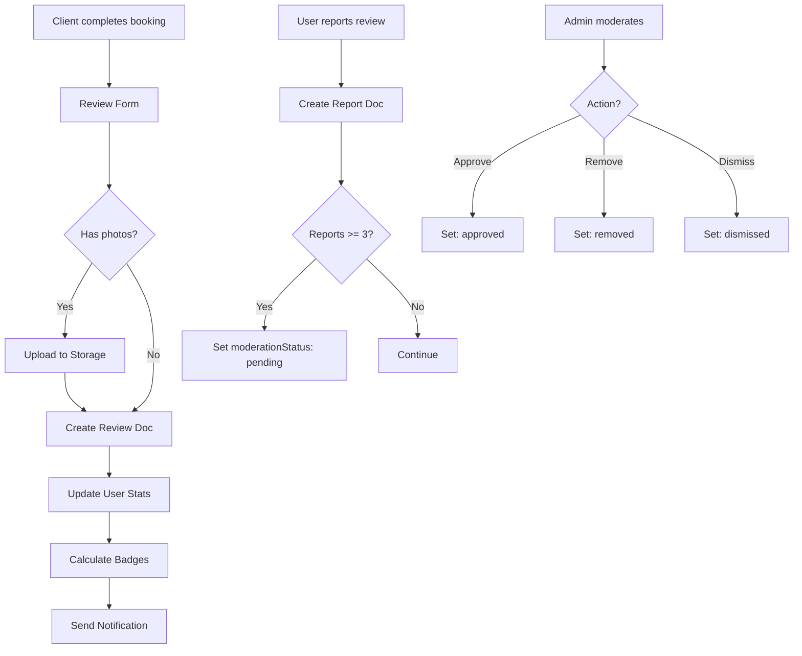
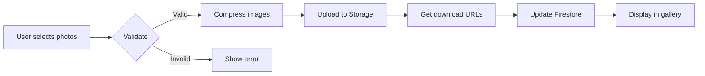

# 📚 Reviews System - Complete Documentation

> **ImuTask Reviews & Ratings System**  
> Complete guide covering architecture, user workflows, admin tools, API reference, security, and testing.

**Version:** 1.0.0  
**Last Updated:** November 7, 2025  
**Status:** ✅ Production Ready

---

## 📋 Table of Contents

1. [System Overview](#system-overview)
2. [Architecture](#architecture)
3. [User Guide](#user-guide)
4. [Admin Moderation Guide](#admin-moderation-guide)
5. [API Reference](#api-reference)
6. [Security & Rules](#security--rules)
7. [Photo Upload System](#photo-upload-system)
8. [E2E Testing](#e2e-testing)
9. [Internationalization](#internationalization)
10. [Troubleshooting](#troubleshooting)

---

## 🎯 System Overview

### Purpose

The ImuTask reviews system enables **clients to rate and review providers** after completed bookings, ensuring trust, transparency, and quality across the platform.

### Key Features

✅ **Comprehensive Ratings**
- Overall rating (1-5 stars)
- Detailed ratings (communication, quality, professionalism, timeliness, value)
- Written comments (20-500 characters)
- Photo attachments (up to 5 photos, 2MB each)

✅ **Provider Responses**
- Public responses to reviews
- Response preview before submission
- Edit/delete capabilities

✅ **Community Moderation**
- User reporting system (6 report reasons)
- Admin moderation panel
- Approve/Remove/Dismiss actions
- Admin notes for audit trail

✅ **Helpful Votes**
- Users can mark reviews as helpful
- Vote counts displayed on reviews
- Influences sort order

✅ **Gamification**
- Automated badge assignment
- 9 badge types (Top Rated, Excellent Service, etc.)
- Badge display on profiles

### Business Rules

1. **One review per booking** - Clients can only review completed bookings once
2. **Verified reviews** - Only actual clients can leave reviews
3. **Provider responses** - Providers can respond to any review they receive
4. **Photo requirements** - JPEG, PNG, WebP; max 2MB; auto-compression
5. **Moderation threshold** - Reviews with 3+ reports trigger moderation
6. **Badge criteria** - Automated calculation based on rating metrics

---

## 🏗️ Architecture

### Tech Stack

| Component | Technology |
|-----------|------------|
| **Frontend** | Next.js 15, React 18, TypeScript |
| **UI Components** | shadcn/ui (Radix UI), Tailwind CSS |
| **Forms** | react-hook-form + zod validation |
| **Backend** | Firebase Firestore |
| **Storage** | Firebase Storage (photos) |
| **Images** | next/image (optimization) |
| **i18n** | next-intl (fr/en/ja) |

### File Structure

```
src/
├── components/
│   ├── review-form.tsx           # Create/edit review form (366 lines)
│   ├── review-card.tsx           # Display single review (388 lines)
│   ├── reviews-list.tsx          # List with filters/sort (230 lines)
│   ├── review-stats-card.tsx     # Stats overview (218 lines)
│   ├── photo-upload.tsx          # Photo upload component (333 lines)
│   ├── photo-gallery.tsx         # Photo gallery display (196 lines)
│   ├── respond-to-review-dialog.tsx  # Provider response dialog (200 lines)
│   └── report-review-dialog.tsx  # Report review dialog (232 lines)
│
├── features/
│   └── reviews/
│       ├── admin/
│       │   ├── moderation-queue.tsx      # Admin queue (234 lines)
│       │   └── review-moderation-form.tsx # Moderation actions (355 lines)
│       └── pages/
│           └── dashboard/reviews/page.tsx # User dashboard (251 lines)
│
├── lib/
│   ├── firestore-reviews.ts      # Core functions (1200+ lines)
│   └── firebase-storage.ts       # Storage helpers
│
├── types/
│   └── reviews.ts                # TypeScript interfaces
│
└── messages/
    ├── fr.json                   # French translations
    ├── en.json                   # English translations
    └── ja.json                   # Japanese translations
```

### Data Model

#### Firestore Collections

**`reviews` collection:**
```typescript
{
  id: string;                    // Auto-generated
  bookingId: string;             // Reference to booking
  reviewerId: string;            // Client who wrote review
  reviewedUserId: string;        // Provider being reviewed
  
  // Ratings
  rating: number;                // Overall (1-5)
  detailedRatings?: {
    communication?: number;      // 1-5
    quality?: number;            // 1-5
    professionalism?: number;    // 1-5
    timeliness?: number;         // 1-5
    valueForMoney?: number;      // 1-5
  };
  
  // Content
  comment: string;               // 20-500 characters
  photos?: string[];             // URLs in Firebase Storage
  
  // Engagement
  helpfulVotes: number;          // Count
  helpfulBy: string[];           // User IDs who voted
  
  // Provider response
  response?: {
    text: string;
    respondedAt: Timestamp;
    respondedBy: string;
  };
  
  // Moderation
  reports: number;               // Report count
  reportedBy: string[];          // Reporter IDs
  moderationStatus?: 'pending' | 'approved' | 'removed' | 'dismissed';
  moderatedBy?: string;          // Admin ID
  moderatedAt?: Timestamp;
  adminNote?: string;
  
  // Metadata
  createdAt: Timestamp;
  updatedAt: Timestamp;
  isVerified: boolean;           // True for actual bookings
}
```

**`review_reports` collection:**
```typescript
{
  id: string;
  reviewId: string;
  reporterId: string;
  reason: 'spam' | 'inappropriate' | 'offensive' | 'fake' | 'irrelevant' | 'other';
  details: string;               // 10-500 characters
  status: 'pending' | 'resolved';
  resolvedBy?: string;
  resolvedAt?: Timestamp;
  createdAt: Timestamp;
}
```

**`review_badges` subcollection** (under `users/{userId}`):
```typescript
{
  badgeType: string;             // top_rated, excellent_service, etc.
  earnedAt: Timestamp;
  criteria: {
    averageRating: number;
    totalReviews: number;
    // Badge-specific criteria
  };
}
```

### Core Functions Flow



---

## 👤 User Guide

### Creating a Review

#### Prerequisites
- ✅ Booking must be completed
- ✅ User must be the client (not provider)
- ✅ No existing review for this booking

#### Step-by-Step

**1. Navigate to Review Form**
- **Option A:** From booking detail page → "Leave a Review" button
- **Option B:** From dashboard → "Reviews" tab → "Reviews to Give"

**2. Fill Out Form**

```typescript
// Required fields
Overall Rating: 1-5 stars (click stars)
Comment: 20-500 characters

// Optional fields
Detailed Ratings: 
  - Communication (1-5)
  - Quality of Work (1-5)
  - Professionalism (1-5)
  - Timeliness (1-5)
  - Value for Money (1-5)

Photos: Up to 5 photos (JPEG/PNG/WebP, max 2MB each)
```

**3. Submit**
- Click "Submit Review"
- Toast notification confirms success
- Review appears immediately on provider's profile

**4. Confirmation**
- Review is marked as "verified" (actual booking)
- Provider receives notification
- Review counts toward provider's stats

### Viewing Reviews

#### On Provider Profile

```typescript
// URL: /profile/{userId}
Components displayed:
  - ReviewStatsCard (overview)
  - ReviewsList (all reviews with filters)
```

**Stats shown:**
- Average rating (weighted)
- Total review count
- Rating distribution (5-star breakdown)
- Detailed averages (communication, quality, etc.)
- Response rate
- Earned badges

**Filters available:**
- All reviews
- Verified only
- With photos
- With responses

**Sort options:**
- Most recent
- Highest rating
- Lowest rating
- Most helpful

#### In Dashboard

```typescript
// URL: /dashboard/reviews
Tabs:
  1. "Reviews Received" - Reviews you got as provider
  2. "Reviews Given" - Reviews you wrote as client
```

### Marking Reviews as Helpful

**Purpose:** Help other users find valuable reviews

**How to:**
1. Click "Helpful" button on any review
2. Count increments immediately
3. Your vote is saved (can't vote twice)

**Display:**
- Shows "{count} found this helpful"
- Influences "Most Helpful" sort order

### Reporting a Review

#### When to Report

Report reviews that contain:
- 🚫 Spam or advertising
- 🚫 Inappropriate content
- 🚫 Offensive language
- 🚫 Fake/fraudulent reviews
- 🚫 Irrelevant content

#### How to Report

**1. Click "Report" button** on review card

**2. Fill Report Dialog**
```typescript
// Required fields
Reason: Select from dropdown (6 options)
Details: 10-500 characters explaining the issue

// Warning shown
"False reports may result in account suspension"
```

**3. Submit**
- Report sent to admin queue
- User receives confirmation
- Original review remains visible (pending moderation)

**4. Moderation Process**
- Admin reviews within 24-48 hours
- Review may be approved/removed/dismissed
- Reporter is NOT notified of outcome (privacy)

### Responding to Reviews (Providers)

#### Prerequisites
- ✅ Must be the reviewed provider
- ✅ Review must be visible (not removed)

#### How to Respond

**1. Navigate to Review**
- Dashboard → Reviews → "Reviews Received"
- Or: Your profile page

**2. Click "Respond" button**

**3. Write Response**
```typescript
// Fields
Response Text: Min 10 characters
Preview: See how it will look

// Tips
✓ Thank the client
✓ Address specific feedback
✓ Stay professional
✗ Don't be defensive
✗ Don't share private info
```

**4. Submit**
- Response appears immediately below review
- Shows "Responded on {date}"
- Increases your response rate stat

**5. Edit/Delete**
- Can edit response anytime
- Can delete response (client's review remains)

---

## 🛡️ Admin Moderation Guide

### Accessing Moderation Panel

**URL:** `/dashboard/admin/moderation`

**Requirements:**
- Admin role in Firestore (`users/{userId}.role === 'admin'`)
- Authenticated session

### Moderation Queue

#### Queue Display

```typescript
// Components shown
ModerationQueue: List of all reported reviews
  - Filter by status (All/Pending/Approved/Removed/Dismissed)
  - Shows: Reviewer name, Rating, Report count, Status badge
  - Action: "Review" button → Opens moderation form
```

**Status badges:**
- 🟡 **Pending** - Awaiting moderation (default for 3+ reports)
- 🟢 **Approved** - Review is legitimate, reports dismissed
- 🔴 **Removed** - Review violated guidelines
- ⚪ **Dismissed** - Reports unfounded, review stays

#### Priority Sorting

Queue automatically sorts by:
1. **Report count** (highest first)
2. **Creation date** (oldest first)

### Moderation Actions

#### Review Moderation Form

**Components:**
```typescript
ReviewModerationForm:
  - Review details (rating, comment, photos)
  - Report count badge
  - Report reasons/details (expandable)
  - Admin note field
  - Action buttons (Approve/Remove/Dismiss)
```

#### Action: Approve Review

**When to use:**
- Review is legitimate
- Reports are unfounded
- Content follows guidelines

**Effect:**
```typescript
moderationStatus: 'approved'
- Review remains visible
- Reports marked as resolved
- Admin note saved (optional)
- Reviewers notified of frivolous reports (if applicable)
```

**Admin note:** Optional but recommended for documentation

#### Action: Remove Review

**When to use:**
- Review violates community guidelines
- Contains spam/offensive content
- Fake/fraudulent review

**Effect:**
```typescript
moderationStatus: 'removed'
- Review hidden from public view
- Still in database (for audit)
- Admin note REQUIRED (explain decision)
- Stats recalculated without this review
```

**Admin note:** **REQUIRED** - Must explain removal reason

#### Action: Dismiss Reports

**When to use:**
- Review is fine but has some reports
- Reports don't warrant action
- Minor issues that don't violate guidelines

**Effect:**
```typescript
moderationStatus: 'dismissed'
- Review remains visible
- Reports marked as resolved
- Admin note saved (optional)
- No impact on stats
```

**Admin note:** Optional

### Moderation Best Practices

**1. Context Review**
- ✓ Check booking details
- ✓ Read all reports
- ✓ Look at reviewer's history
- ✓ Check provider's response (if any)

**2. Consistency**
- ✓ Follow established guidelines
- ✓ Document decisions in admin notes
- ✓ Be objective and impartial
- ✓ Consult team on borderline cases

**3. Timing**
- ✓ Process queue daily
- ✓ Prioritize high-report-count reviews
- ✓ Aim for <48h response time
- ✓ Escalate urgent cases

**4. Communication**
- ✓ Use clear, professional language in notes
- ✓ Document edge cases for future reference
- ✓ Update moderation guidelines as needed

### Audit Trail

All moderation actions are logged:
```typescript
{
  moderatedBy: string;        // Admin user ID
  moderatedAt: Timestamp;     // Action timestamp
  adminNote: string;          // Decision explanation
  action: 'approved' | 'removed' | 'dismissed';
}
```

Access via: Firestore console → `reviews` collection → Review document

---

## 🔌 API Reference

### Core Functions

All functions located in: `src/lib/firestore-reviews.ts`

---

#### `createReview(input: CreateReviewInput): Promise<string>`

**Purpose:** Create a new review for a completed booking

**Parameters:**
```typescript
interface CreateReviewInput {
  bookingId: string;
  reviewerId: string;
  reviewedUserId: string;
  rating: number;              // 1-5
  comment: string;             // 20-500 chars
  detailedRatings?: {
    communication?: number;
    quality?: number;
    professionalism?: number;
    timeliness?: number;
    valueForMoney?: number;
  };
  photos?: File[];             // Max 5 files
}
```

**Returns:** `reviewId` (string)

**Throws:**
- "Booking not found"
- "Booking not completed"
- "Review already exists for this booking"
- "Invalid rating value"
- "Comment too short/long"

**Example:**
```typescript
const reviewId = await createReview({
  bookingId: 'booking123',
  reviewerId: 'user456',
  reviewedUserId: 'provider789',
  rating: 5,
  comment: 'Excellent service! Very professional and timely.',
  detailedRatings: {
    communication: 5,
    quality: 5,
    professionalism: 5,
    timeliness: 5,
    valueForMoney: 4
  },
  photos: [file1, file2]
});
```

---

#### `getReviewsByUser(userId: string): Promise<Review[]>`

**Purpose:** Get all reviews for a specific user (provider)

**Parameters:**
- `userId` - Provider's user ID

**Returns:** Array of `Review` objects, sorted by date (newest first)

**Example:**
```typescript
const reviews = await getReviewsByUser('provider789');
// Returns: [{ id, rating, comment, ... }, ...]
```

---

#### `getReviewsByReviewer(reviewerId: string): Promise<Review[]>`

**Purpose:** Get all reviews written by a specific user (client)

**Parameters:**
- `reviewerId` - Client's user ID

**Returns:** Array of `Review` objects

**Example:**
```typescript
const myReviews = await getReviewsByReviewer('user456');
```

---

#### `getReviewByBooking(bookingId: string): Promise<Review | null>`

**Purpose:** Get review for a specific booking

**Parameters:**
- `bookingId` - Booking document ID

**Returns:** `Review` object or `null` if no review exists

**Example:**
```typescript
const review = await getReviewByBooking('booking123');
if (review) {
  console.log(`Rating: ${review.rating}`);
}
```

---

#### `hasUserReviewed(bookingId: string, userId: string): Promise<boolean>`

**Purpose:** Check if user has already reviewed a booking

**Parameters:**
- `bookingId` - Booking document ID
- `userId` - User ID to check

**Returns:** `boolean` (true if review exists)

**Example:**
```typescript
const alreadyReviewed = await hasUserReviewed('booking123', 'user456');
if (alreadyReviewed) {
  // Show "Already reviewed" message
}
```

---

#### `updateReview(reviewId: string, updates: Partial<Review>): Promise<void>`

**Purpose:** Update an existing review

**Parameters:**
- `reviewId` - Review document ID
- `updates` - Partial review object with fields to update

**Allowed updates:**
- `rating`
- `comment`
- `detailedRatings`
- `photos`

**Throws:**
- "Review not found"
- "Not authorized to update this review"

**Example:**
```typescript
await updateReview('review123', {
  rating: 4,
  comment: 'Updated: Good service overall.'
});
```

---

#### `deleteReview(reviewId: string, userId: string): Promise<void>`

**Purpose:** Delete a review (soft delete)

**Parameters:**
- `reviewId` - Review document ID
- `userId` - User requesting deletion (must be reviewer)

**Effect:**
- Sets `deleted: true` (soft delete)
- Removes from public views
- Recalculates provider stats

**Throws:**
- "Review not found"
- "Not authorized to delete this review"

**Example:**
```typescript
await deleteReview('review123', 'user456');
```

---

#### `respondToReview(reviewId: string, providerId: string, responseText: string): Promise<void>`

**Purpose:** Add provider response to a review

**Parameters:**
- `reviewId` - Review document ID
- `providerId` - Provider user ID
- `responseText` - Response text (min 10 chars)

**Effect:**
- Adds `response` object to review
- Updates provider's response rate
- Sends notification to reviewer

**Throws:**
- "Review not found"
- "Not authorized to respond"
- "Response too short"

**Example:**
```typescript
await respondToReview(
  'review123',
  'provider789',
  'Thank you for your feedback! I appreciate your business.'
);
```

---

#### `deleteResponse(reviewId: string, providerId: string): Promise<void>`

**Purpose:** Delete provider response from review

**Parameters:**
- `reviewId` - Review document ID
- `providerId` - Provider user ID

**Effect:**
- Removes `response` object
- Updates provider's response rate
- Original review remains

**Example:**
```typescript
await deleteResponse('review123', 'provider789');
```

---

#### `markReviewHelpful(reviewId: string, userId: string): Promise<void>`

**Purpose:** Mark a review as helpful (vote)

**Parameters:**
- `reviewId` - Review document ID
- `userId` - User voting

**Effect:**
- Increments `helpfulVotes` count
- Adds user to `helpfulBy` array
- Prevents duplicate votes

**Throws:**
- "Review not found"
- "Already voted"

**Example:**
```typescript
await markReviewHelpful('review123', 'user999');
```

---

#### `reportReview(input: ReportReviewInput): Promise<string>`

**Purpose:** Report a review for moderation

**Parameters:**
```typescript
interface ReportReviewInput {
  reviewId: string;
  reporterId: string;
  reason: 'spam' | 'inappropriate' | 'offensive' | 'fake' | 'irrelevant' | 'other';
  details: string;             // 10-500 chars
}
```

**Returns:** `reportId` (string)

**Effect:**
- Creates document in `review_reports` collection
- Increments review's `reports` count
- Adds reporter to `reportedBy` array
- Auto-sets `moderationStatus: 'pending'` if reports >= 3

**Throws:**
- "Review not found"
- "Already reported by this user"
- "Invalid reason"

**Example:**
```typescript
const reportId = await reportReview({
  reviewId: 'review123',
  reporterId: 'user999',
  reason: 'spam',
  details: 'This review contains advertising links.'
});
```

---

#### `moderateReview(input: ModerateReviewInput): Promise<void>`

**Purpose:** Admin action to moderate a review

**Parameters:**
```typescript
interface ModerateReviewInput {
  reviewId: string;
  adminId: string;
  action: 'approve' | 'remove' | 'dismiss';
  adminNote?: string;          // Required for 'remove'
}
```

**Effect:**
- Sets `moderationStatus`
- Records `moderatedBy` and `moderatedAt`
- Saves `adminNote`
- Marks related reports as resolved
- Recalculates stats if removed

**Throws:**
- "Review not found"
- "Not authorized (not admin)"
- "Admin note required for removal"

**Example:**
```typescript
await moderateReview({
  reviewId: 'review123',
  adminId: 'admin001',
  action: 'remove',
  adminNote: 'Contains offensive language violating community guidelines.'
});
```

---

#### `getReviewStats(userId: string): Promise<ReviewStats>`

**Purpose:** Calculate aggregated review statistics for a user

**Parameters:**
- `userId` - Provider user ID

**Returns:**
```typescript
interface ReviewStats {
  averageRating: number;       // Weighted average
  totalReviews: number;
  ratingDistribution: {
    5: number;
    4: number;
    3: number;
    2: number;
    1: number;
  };
  detailedAverages: {
    communication: number;
    quality: number;
    professionalism: number;
    timeliness: number;
    valueForMoney: number;
  };
  responseRate: number;        // Percentage (0-100)
  badges: Badge[];
}
```

**Example:**
```typescript
const stats = await getReviewStats('provider789');
console.log(`Average: ${stats.averageRating} stars`);
console.log(`Total: ${stats.totalReviews} reviews`);
console.log(`Response rate: ${stats.responseRate}%`);
```

---

#### `calculateBadges(userId: string): Promise<Badge[]>`

**Purpose:** Calculate and assign badges based on review performance

**Parameters:**
- `userId` - Provider user ID

**Returns:** Array of earned badges

**Badge Types:**
```typescript
const BADGE_TYPES = [
  'top_rated',           // Avg rating >= 4.8, 20+ reviews
  'excellent_service',   // Quality avg >= 4.7
  'responsive',          // Communication avg >= 4.7
  'verified_pro',        // 50+ reviews
  'rising_star',         // 10+ reviews, all within 3 months
  'reliable',            // Timeliness avg >= 4.7
  'great_communicator',  // Response rate >= 90%
  'punctual',            // Timeliness avg >= 4.8
  'value_champion'       // Value avg >= 4.7
];
```

**Example:**
```typescript
const badges = await calculateBadges('provider789');
// Returns: [{ badgeType: 'top_rated', earnedAt: ... }, ...]
```

---

### Photo Upload Functions

Located in: `src/lib/firebase-storage.ts`

---

#### `uploadReviewPhoto(reviewId: string, file: File): Promise<string>`

**Purpose:** Upload a single review photo to Firebase Storage

**Parameters:**
- `reviewId` - Review document ID
- `file` - Image file (JPEG/PNG/WebP)

**Returns:** Download URL (string)

**Process:**
1. Validates file type and size
2. Compresses image (max 1920x1080, quality 80%)
3. Uploads to `reviews/{reviewId}/photos/{filename}`
4. Returns public URL

**Throws:**
- "Invalid file type"
- "File too large (max 2MB before compression)"
- "Upload failed"

**Example:**
```typescript
const photoUrl = await uploadReviewPhoto('review123', imageFile);
// Returns: "https://firebasestorage.googleapis.com/..."
```

---

#### `deleteReviewPhoto(photoUrl: string): Promise<void>`

**Purpose:** Delete a review photo from storage

**Parameters:**
- `photoUrl` - Full Firebase Storage URL

**Effect:**
- Deletes file from storage
- Updates review document (removes URL from photos array)

**Example:**
```typescript
await deleteReviewPhoto('https://firebasestorage.googleapis.com/.../photo.jpg');
```

---

## 🔒 Security & Rules

### Firestore Security Rules

Located in: `firestore.rules`

#### Reviews Collection

```javascript
match /reviews/{reviewId} {
  // Read: Public (anyone can read reviews)
  allow read: if true;
  
  // Create: Only authenticated users who are clients of the booking
  allow create: if request.auth != null
    && request.resource.data.reviewerId == request.auth.uid
    && isClient(request.resource.data.bookingId, request.auth.uid)
    && !hasExistingReview(request.resource.data.bookingId)
    && request.resource.data.rating >= 1 
    && request.resource.data.rating <= 5
    && request.resource.data.comment.size() >= 20
    && request.resource.data.comment.size() <= 500;
  
  // Update: Only review owner or admin
  allow update: if request.auth != null
    && (
      // Review owner can update content
      (resource.data.reviewerId == request.auth.uid
        && !request.resource.data.diff(resource.data).affectedKeys()
          .hasAny(['reviewerId', 'reviewedUserId', 'bookingId']))
      
      // Provider can add/update response
      || (resource.data.reviewedUserId == request.auth.uid
        && request.resource.data.diff(resource.data).affectedKeys()
          .hasOnly(['response', 'updatedAt']))
      
      // Admin can moderate
      || (isAdmin(request.auth.uid)
        && request.resource.data.diff(resource.data).affectedKeys()
          .hasAny(['moderationStatus', 'moderatedBy', 'moderatedAt', 'adminNote']))
    );
  
  // Delete: Only review owner or admin
  allow delete: if request.auth != null
    && (resource.data.reviewerId == request.auth.uid 
        || isAdmin(request.auth.uid));
}
```

#### Review Reports Collection

```javascript
match /review_reports/{reportId} {
  // Read: Only admins
  allow read: if isAdmin(request.auth.uid);
  
  // Create: Authenticated users (can't report own reviews)
  allow create: if request.auth != null
    && request.resource.data.reporterId == request.auth.uid
    && request.resource.data.reason in ['spam', 'inappropriate', 'offensive', 'fake', 'irrelevant', 'other']
    && request.resource.data.details.size() >= 10
    && request.resource.data.details.size() <= 500;
  
  // Update: Only admins (resolving reports)
  allow update: if isAdmin(request.auth.uid);
  
  // Delete: Only admins
  allow delete: if isAdmin(request.auth.uid);
}
```

#### Helper Functions

```javascript
function isClient(bookingId, userId) {
  return get(/databases/$(database)/documents/bookings/$(bookingId))
    .data.clientId == userId;
}

function hasExistingReview(bookingId) {
  return exists(/databases/$(database)/documents/reviews/$(bookingId));
}

function isAdmin(userId) {
  return get(/databases/$(database)/documents/users/$(userId))
    .data.role == 'admin';
}
```

### Storage Security Rules

Located in: `storage.rules`

```javascript
match /reviews/{reviewId}/photos/{photoName} {
  // Read: Public
  allow read: if true;
  
  // Write: Only authenticated users who own the review
  allow write: if request.auth != null
    && get(/databases/$(database)/documents/reviews/$(reviewId))
      .data.reviewerId == request.auth.uid
    && request.resource.size < 2 * 1024 * 1024  // 2MB limit
    && request.resource.contentType.matches('image/(jpeg|png|webp)');
  
  // Delete: Review owner or admin
  allow delete: if request.auth != null
    && (get(/databases/$(database)/documents/reviews/$(reviewId))
        .data.reviewerId == request.auth.uid
      || get(/databases/$(database)/documents/users/$(request.auth.uid))
        .data.role == 'admin');
}
```

### Validation Rules

#### Client-Side (Zod Schemas)

```typescript
// Review creation schema
export const createReviewSchema = z.object({
  rating: z.number().min(1).max(5),
  comment: z.string().min(20).max(500),
  detailedRatings: z.object({
    communication: z.number().min(1).max(5).optional(),
    quality: z.number().min(1).max(5).optional(),
    professionalism: z.number().min(1).max(5).optional(),
    timeliness: z.number().min(1).max(5).optional(),
    valueForMoney: z.number().min(1).max(5).optional(),
  }).optional(),
  photos: z.array(z.instanceof(File)).max(5).optional(),
});

// Response schema
export const responseSchema = z.object({
  text: z.string().min(10).max(1000),
});

// Report schema
export const reportSchema = z.object({
  reason: z.enum(['spam', 'inappropriate', 'offensive', 'fake', 'irrelevant', 'other']),
  details: z.string().min(10).max(500),
});
```

---

## 📸 Photo Upload System

### Architecture

**Components:**
1. **PhotoUpload** - Drag-drop interface with preview
2. **PhotoGallery** - Display uploaded photos with lightbox
3. **Image compression** - Automatic optimization
4. **Firebase Storage** - Persistent storage

### Upload Flow



### Photo Upload Component

**Location:** `src/components/photo-upload.tsx` (333 lines)

**Features:**
- ✅ Drag-and-drop interface
- ✅ Click to select files
- ✅ Image preview before upload
- ✅ Progress indicators
- ✅ Remove photos before upload
- ✅ File type validation
- ✅ Size validation (2MB before compression)
- ✅ Auto-compression (max 1920x1080, 80% quality)

**Props:**
```typescript
interface PhotoUploadProps {
  reviewId?: string;           // For existing reviews
  photos: string[];            // Current photo URLs
  onPhotosChange: (photos: string[]) => void;
  maxPhotos?: number;          // Default: 5
  maxSizeBytes?: number;       // Default: 2MB
  disabled?: boolean;
}
```

**Usage:**
```tsx
<PhotoUpload
  photos={photos}
  onPhotosChange={setPhotos}
  maxPhotos={5}
  disabled={isSubmitting}
/>
```

### Photo Gallery Component

**Location:** `src/components/photo-gallery.tsx` (196 lines)

**Features:**
- ✅ Responsive grid layout (2-4 columns)
- ✅ Lightbox view (click to enlarge)
- ✅ Navigation (prev/next arrows)
- ✅ Keyboard navigation (←/→ arrows, Escape)
- ✅ Delete capability (for owners)
- ✅ next/image optimization
- ✅ Loading states

**Props:**
```typescript
interface PhotoGalleryProps {
  photos: string[];
  canDelete?: boolean;
  onDelete?: (photoUrl: string) => Promise<void>;
}
```

**Usage:**
```tsx
<PhotoGallery
  photos={review.photos || []}
  canDelete={isOwner}
  onDelete={handleDeletePhoto}
/>
```

### Image Compression

**Library:** browser-image-compression

**Settings:**
```typescript
const compressionOptions = {
  maxSizeMB: 1,              // Target 1MB after compression
  maxWidthOrHeight: 1920,    // Max dimension
  useWebWorker: true,        // Background processing
  initialQuality: 0.8,       // 80% quality
};
```

**Process:**
1. User selects file
2. Validate file type (JPEG/PNG/WebP)
3. Check size (max 2MB before compression)
4. Compress in background worker
5. Upload compressed file
6. Return download URL

**Result:** Typical 2MB photos compress to ~200-400KB

### Storage Organization

**Path structure:**
```
reviews/
  {reviewId}/
    photos/
      {timestamp}_{random}_{originalname}
```

**Example:**
```
reviews/review123/photos/1699372800000_a8f2_garden-before.jpg
```

**Benefits:**
- ✅ Easy to locate photos by review
- ✅ Unique filenames (timestamp + random)
- ✅ Preserves original filename (for debugging)
- ✅ Easy cleanup (delete review = delete folder)

### Best Practices

**For Users:**
- 📸 Use clear, well-lit photos
- 📸 Show relevant details (before/after, results)
- 📸 Avoid including people without consent
- 📸 Use JPEG for photos, PNG for screenshots

**For Developers:**
- ✅ Always compress before upload
- ✅ Validate file types server-side too
- ✅ Set appropriate CORS rules
- ✅ Monitor storage usage
- ✅ Implement cleanup for deleted reviews
- ✅ Use next/image for optimization

---

## 🧪 E2E Testing

### Test Infrastructure

**Location:** `e2e/reviews-system.spec.ts` (634 lines, 20+ scenarios)

**Framework:** Playwright

**Data-testid Coverage:** 64 attributes across all components

### Data-testid Reference

#### Review Form (8 testids)
```typescript
review-form                  // Form container
review-form-overall-rating   // Overall rating stars
review-form-comment          // Comment textarea
review-form-detailed-ratings // Detailed section
review-form-photo-upload     // Photo upload area
review-form-preview          // Preview section
review-form-cancel           // Cancel button
review-form-submit           // Submit button
```

#### Review Card (10 testids)
```typescript
review-card-{id}            // Card container (dynamic)
review-rating               // Rating display
review-comment              // Comment text
review-photos               // Photo gallery
review-helpful-button       // Helpful vote button
review-helpful-count        // Vote count
review-report-button        // Report button
review-respond-button       // Respond button
review-response             // Provider response
review-response-date        // Response date
```

#### Reviews List (3 testids)
```typescript
reviews-list                // List container
reviews-list-loading        // Loading state
reviews-list-empty          // Empty state
```

#### Review Stats Card (13 testids)
```typescript
review-stats-card           // Card container
stats-average-rating        // Average rating
stats-total-reviews         // Total count
stats-distribution          // Distribution section
stats-distribution-{1-5}    // Each star count (dynamic)
stats-detailed-averages     // Detailed section
stats-detailed-{type}       // Each detailed rating (dynamic)
stats-response-rate         // Response rate
stats-badges                // Badges section
```

#### Dashboard Pages (8 testids)
```typescript
reviews-page                // Main reviews page
reviews-tabs                // Tabs component
reviews-tab-received        // Received tab
reviews-tab-given           // Given tab

profile-tabs                // Profile tabs
profile-reviews-tab         // Reviews tab trigger
profile-reviews-section     // Reviews content

already-reviewed-message    // Already reviewed alert
```

#### Moderation (14 testids)
```typescript
moderation-queue            // Queue container
moderation-filter           // Status filter
moderation-loading          // Loading state
moderation-empty            // Empty state
moderation-list             // List container
moderation-item-{id}        // Queue item (dynamic)
moderation-status-{id}      // Status badge (dynamic)
moderation-review-button-{id} // Review button (dynamic)

moderation-form             // Form container
moderation-report-count     // Report count badge
moderation-admin-note       // Admin note textarea
moderation-cancel-button    // Cancel button
moderation-dismiss-button   // Dismiss button
moderation-approve-button   // Approve button
moderation-remove-button    // Remove button
```

#### Dialogs (10 testids)
```typescript
// Respond Dialog
response-dialog             // Dialog container
response-text-input         // Text input
response-preview            // Preview area
response-cancel-button      // Cancel button
response-submit-button      // Submit button

// Report Dialog
report-dialog               // Dialog container
report-reason-select        // Reason dropdown
report-details-input        // Details textarea
report-cancel-button        // Cancel button
report-submit-button        // Submit button
```

### Test Scenarios

**Full test coverage in:** `e2e/reviews-system.spec.ts`

#### User Flows (10 tests)
1. ✅ Create review with overall rating only
2. ✅ Create review with detailed ratings
3. ✅ Create review with photos
4. ✅ View reviews on provider profile
5. ✅ Filter reviews (verified, with photos, with responses)
6. ✅ Sort reviews (recent, highest, lowest, helpful)
7. ✅ Mark review as helpful
8. ✅ Report a review
9. ✅ Provider responds to review
10. ✅ Edit/delete response

#### Admin Flows (6 tests)
1. ✅ View moderation queue
2. ✅ Filter queue by status
3. ✅ Approve review
4. ✅ Remove review with admin note
5. ✅ Dismiss reports
6. ✅ Verify audit trail

#### Edge Cases (4 tests)
1. ✅ Prevent duplicate reviews
2. ✅ Prevent self-review
3. ✅ Handle photo upload errors
4. ✅ Handle offline state

### Running Tests

```bash
# Run all review tests
pnpm test:e2e e2e/reviews-system.spec.ts

# Run specific test
pnpm test:e2e e2e/reviews-system.spec.ts -g "Create review with photos"

# Run in UI mode (debugging)
pnpm test:e2e:ui e2e/reviews-system.spec.ts

# Run with trace
pnpm test:e2e e2e/reviews-system.spec.ts --trace on
```

### Test Helpers

**Location:** `e2e/helpers/reviews-helpers.ts` (328 lines, 20+ functions)

**Key helpers:**
```typescript
// Setup
createTestBooking()         // Create completed booking
createTestReview()          // Create review with data

// Actions
fillReviewForm()            // Fill out review form
submitReview()              // Submit review
uploadPhotos()              // Upload review photos
reportReview()              // Report a review
respondToReview()           // Add provider response

// Assertions
expectReviewVisible()       // Check review appears
expectRating()              // Verify rating value
expectPhotoCount()          // Verify photo count
expectBadge()               // Check badge earned

// Admin
moderateReview()            // Admin moderation action
expectModerationStatus()    // Verify status
```

### Test Data

**Mock data location:** `e2e/fixtures/reviews-fixtures.ts`

**Sample data:**
```typescript
export const testReview = {
  rating: 5,
  comment: 'Excellent service! Very professional and timely.',
  detailedRatings: {
    communication: 5,
    quality: 5,
    professionalism: 5,
    timeliness: 5,
    valueForMoney: 4
  }
};

export const testReports = {
  spam: {
    reason: 'spam',
    details: 'This review contains advertising links.'
  },
  offensive: {
    reason: 'offensive',
    details: 'Contains inappropriate language.'
  }
};
```

---

## 🌍 Internationalization

### Supported Languages

- 🇫🇷 **French (fr)** - Default
- 🇬🇧 **English (en)**
- 🇯🇵 **Japanese (ja)**

### Translation Files

**Location:** `src/messages/{locale}.json`

**Structure:**
```json
{
  "Reviews": {
    "form": { /* ... */ },
    "card": { /* ... */ },
    "stats": { /* ... */ },
    "filters": { /* ... */ },
    "badges": { /* ... */ },
    "empty": { /* ... */ },
    "respond": { /* ... */ },
    "report": { /* ... */ },
    "photoUpload": { /* ... */ }
  },
  "Admin": {
    "moderation": { /* ... */ }
  }
}
```

### Usage in Components

**Client components:**
```typescript
'use client';
import { useTranslations } from 'next-intl';

export function ReviewCard() {
  const t = useTranslations('Reviews.card');
  
  return (
    <div>
      <button>{t('helpful')}</button>
      <button>{t('report')}</button>
    </div>
  );
}
```

**Server components:**
```typescript
import { getTranslations } from 'next-intl/server';

export default async function ReviewsPage() {
  const t = await getTranslations('Reviews.form');
  
  return <h1>{t('title')}</h1>;
}
```

### Adding New Languages

**1. Create translation file:**
```bash
cp src/messages/en.json src/messages/es.json
```

**2. Translate all keys:**
- Keep keys identical (only translate values)
- Maintain placeholders: `{name}`, `{count}`, `{date}`
- Test dynamic plurals

**3. Update i18n config:**
```typescript
// src/i18n.ts
export const locales = ['en', 'fr', 'ja', 'es'];
```

**4. Test thoroughly:**
- All pages render
- Forms validate
- Notifications display
- Date/time formatting

---

## 🐛 Troubleshooting

### Common Issues

#### "Review already exists for this booking"

**Cause:** User trying to create duplicate review

**Solution:**
1. Check if review exists: `hasUserReviewed(bookingId, userId)`
2. Show "Already reviewed" message with link to existing review
3. Offer "Edit review" instead

**Code:**
```typescript
const alreadyReviewed = await hasUserReviewed(bookingId, userId);
if (alreadyReviewed) {
  toast.error('You have already reviewed this booking');
  router.push(`/dashboard/reviews?tab=given`);
  return;
}
```

---

#### Photos not uploading

**Possible causes:**
1. File too large (>2MB before compression)
2. Invalid file type
3. Storage rules incorrect
4. Network timeout

**Debug steps:**
```typescript
// 1. Check file size
console.log('File size:', file.size / 1024 / 1024, 'MB');

// 2. Check file type
console.log('File type:', file.type);
console.log('Valid:', ['image/jpeg', 'image/png', 'image/webp'].includes(file.type));

// 3. Test compression
const compressed = await imageCompression(file, compressionOptions);
console.log('Compressed size:', compressed.size / 1024 / 1024, 'MB');

// 4. Check Storage rules
// Go to Firebase Console → Storage → Rules
```

**Common fixes:**
- ✅ Update Storage rules to allow `image/webp`
- ✅ Increase timeout: `uploadBytesResumable(ref, file, { timeout: 60000 })`
- ✅ Handle compression errors gracefully

---

#### Reviews not appearing on profile

**Possible causes:**
1. Moderation status = 'removed'
2. Firestore security rules blocking read
3. Query filter too restrictive
4. Cache not invalidated

**Debug steps:**
```typescript
// 1. Check Firestore directly
const reviewsSnapshot = await db
  .collection('reviews')
  .where('reviewedUserId', '==', userId)
  .get();

console.log('Found reviews:', reviewsSnapshot.size);
reviewsSnapshot.forEach(doc => {
  console.log('Review:', doc.id, doc.data());
});

// 2. Check moderation status
reviewsSnapshot.forEach(doc => {
  const status = doc.data().moderationStatus;
  console.log(`Review ${doc.id} status:`, status || 'none');
});

// 3. Check security rules
// Should allow: allow read: if true;
```

**Common fixes:**
- ✅ Exclude removed reviews: `.where('moderationStatus', '!=', 'removed')`
- ✅ Update security rules
- ✅ Clear browser cache
- ✅ Check user is published: `where('reviewedUserId', '==', userId)`

---

#### Badge not showing after meeting criteria

**Possible causes:**
1. Badge calculation not triggered
2. Criteria calculation incorrect
3. Cache not updated

**Debug steps:**
```typescript
// 1. Manually trigger calculation
const badges = await calculateBadges(userId);
console.log('Calculated badges:', badges);

// 2. Check stats
const stats = await getReviewStats(userId);
console.log('Stats:', stats);

// 3. Check criteria for specific badge
const topRatedCriteria = {
  averageRating: stats.averageRating >= 4.8,
  totalReviews: stats.totalReviews >= 20
};
console.log('Top Rated criteria:', topRatedCriteria);
```

**Common fixes:**
- ✅ Call `calculateBadges()` after creating review
- ✅ Add Cloud Function trigger on review creation
- ✅ Clear badge cache
- ✅ Verify criteria thresholds are correct

---

#### Moderation queue not updating

**Possible causes:**
1. Admin role not set
2. Query filter incorrect
3. Real-time listener not attached

**Debug steps:**
```typescript
// 1. Check admin role
const userDoc = await db.collection('users').doc(adminId).get();
console.log('User role:', userDoc.data()?.role);

// 2. Check moderation status field
const reviews = await db
  .collection('reviews')
  .where('moderationStatus', '==', 'pending')
  .get();
console.log('Pending reviews:', reviews.size);

// 3. Attach listener
const unsubscribe = db
  .collection('reviews')
  .where('reports', '>=', 3)
  .onSnapshot(snapshot => {
    console.log('Queue updated, size:', snapshot.size);
  });
```

**Common fixes:**
- ✅ Set user role: `db.collection('users').doc(userId).update({ role: 'admin' })`
- ✅ Check query uses correct field names
- ✅ Ensure real-time listener is attached
- ✅ Check Firestore indexes exist

---

#### Translations not loading

**Possible causes:**
1. Missing translation keys
2. Locale not set correctly
3. Translation file syntax error

**Debug steps:**
```typescript
// 1. Check locale
import { useLocale } from 'next-intl';
const locale = useLocale();
console.log('Current locale:', locale);

// 2. Check translation key exists
const t = useTranslations('Reviews.form');
console.log('Translation:', t('rating.label'));

// 3. Check file syntax
// Run: pnpm build
// Look for JSON parse errors
```

**Common fixes:**
- ✅ Add missing keys to translation files
- ✅ Verify JSON syntax (no trailing commas)
- ✅ Use correct namespace: `Reviews.card` not `reviews.card`
- ✅ Check middleware locale detection

---

### Performance Issues

#### Slow review loading

**Optimization strategies:**

1. **Pagination:**
```typescript
const reviews = await db
  .collection('reviews')
  .where('reviewedUserId', '==', userId)
  .orderBy('createdAt', 'desc')
  .limit(10)  // Load 10 at a time
  .get();
```

2. **Firestore indexes:**
```json
// firestore.indexes.json
{
  "indexes": [
    {
      "collectionGroup": "reviews",
      "queryScope": "COLLECTION",
      "fields": [
        { "fieldPath": "reviewedUserId", "order": "ASCENDING" },
        { "fieldPath": "createdAt", "order": "DESCENDING" }
      ]
    }
  ]
}
```

3. **Next.js caching:**
```typescript
// Use React Server Components
export const revalidate = 60; // Revalidate every 60 seconds

export default async function ReviewsPage() {
  const reviews = await getReviewsByUser(userId);
  return <ReviewsList reviews={reviews} />;
}
```

4. **Image optimization:**
```tsx
<Image
  src={photoUrl}
  width={400}
  height={300}
  loading="lazy"  // Lazy load images
  quality={80}    // Reduce quality
/>
```

---

### Debug Mode

**Enable debug logging:**

```typescript
// src/lib/firestore-reviews.ts
const DEBUG = process.env.NEXT_PUBLIC_DEBUG === 'true';

function log(...args: any[]) {
  if (DEBUG) console.log('[Reviews]', ...args);
}

export async function createReview(input: CreateReviewInput) {
  log('Creating review:', input);
  try {
    // ... code ...
    log('Review created:', reviewId);
  } catch (error) {
    log('Error:', error);
    throw error;
  }
}
```

**Enable in development:**
```bash
# .env.local
NEXT_PUBLIC_DEBUG=true
```

---

## 📚 Additional Resources

### Documentation Files

- **Phase 8 Complete:** `docs/MVP_PHASE8_REVIEWS_COMPLETE.md`
- **E2E Guide:** `docs/REVIEWS_E2E_DATA_TESTID_GUIDE.md`
- **Architecture:** `docs/TECHNICAL_ARCHITECTURE.md` (sections 7-8)
- **Firestore Setup:** `docs/FIRESTORE_SETUP_SUMMARY.md`

### Code Examples

**Example implementation:** See `src/app/[locale]/profile/[userId]/page.tsx`

**Test examples:** See `e2e/reviews-system.spec.ts`

### External Links

- [Firebase Security Rules](https://firebase.google.com/docs/rules)
- [Firestore Best Practices](https://firebase.google.com/docs/firestore/best-practices)
- [next-intl Documentation](https://next-intl-docs.vercel.app/)
- [Playwright Testing](https://playwright.dev/)
- [shadcn/ui Components](https://ui.shadcn.com/)

---

## 🎉 Conclusion

The ImuTask reviews system is a **production-ready, comprehensive solution** for managing user reviews, provider ratings, and community moderation. With 64 data-testid attributes, extensive E2E test coverage, multi-language support, and robust security rules, the system ensures trust, transparency, and quality across the platform.

**Key achievements:**
- ✅ 10+ components (2,500+ lines)
- ✅ 20+ Firestore functions
- ✅ 64 E2E test selectors
- ✅ 3 languages (fr/en/ja)
- ✅ Complete admin moderation
- ✅ Photo upload system
- ✅ Real-time updates
- ✅ Gamification (badges)

**Next steps for enhancement:**
- 📊 Advanced analytics dashboard
- 🤖 AI-powered content moderation
- 📧 Email notifications for reviews
- 🎯 Review invitation system
- 📱 Mobile app support
- 🌐 Additional languages

---

**Need help?** Refer to the [Troubleshooting](#troubleshooting) section or check the codebase documentation.

**Last Updated:** November 7, 2025  
**Maintained by:** ImuTask Development Team
