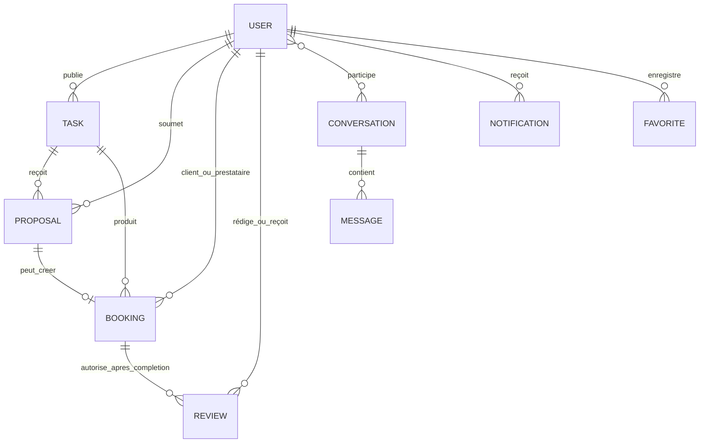
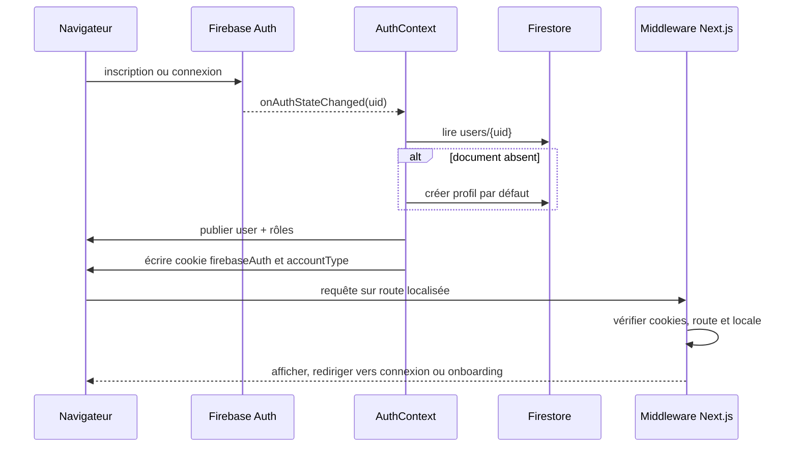
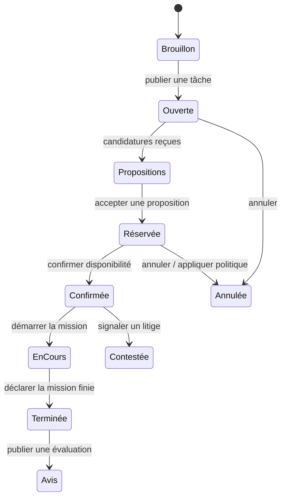
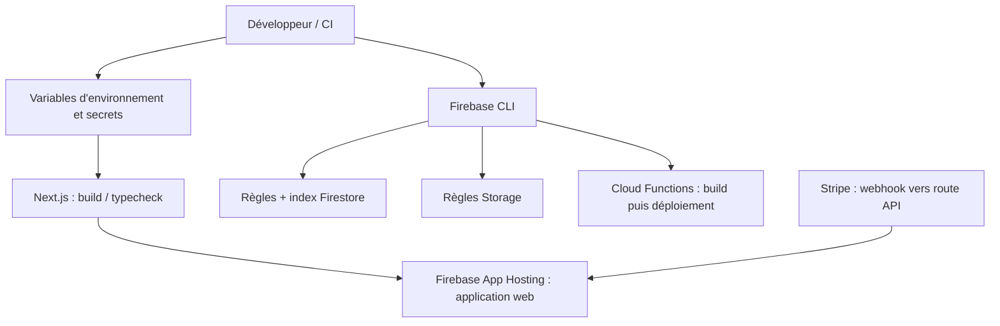

# Dossier technique et fonctionnel — ImuTask

> Analyse du dépôt au 8 octobre 2026. Ce document décrit les éléments repérés dans le code et la configuration présents dans ce dépôt. Les fichiers de roadmap et de sessions historiques peuvent refléter un état antérieur ou une intention ; lorsqu'ils divergent du code, le code est privilégié. Aucun test ni déploiement n'a été exécuté pour produire cette analyse.

## Sommaire

1. [Architecture](#1-architecture)
2. [Base de données et authentification](#2-base-de-données-et-authentification)
3. [Fonctionnalités cœurs](#3-fonctionnalités-cœurs)
4. [Tests, sécurité et déploiement](#4-tests-sécurité-et-déploiement)

---

## 1. Architecture

### 1.1 Vue d'ensemble

ImuTask est une application web de mise en relation autour de tâches et de services de proximité. Le dépôt contient principalement un frontend Next.js en TypeScript, qui consomme directement Firebase côté navigateur, des routes API Next.js pour les opérations Stripe sensibles et un petit ensemble de Cloud Functions Firebase. Ce n'est pas l'architecture Postgres/tRPC/Redis décrite dans certains documents historiques : aucun de ces composants n'est déclaré dans les dépendances du projet observé.

```mermaid
flowchart LR
  Visiteur[Visiteur / Client / Prestataire / Admin]
  subgraph Web[Application web — Next.js 15, React 18, TypeScript]
    Pages[App Router<br/>src/app/[locale]]
    UI[Composants, formulaires et hooks]
    Domain[Services métier<br/>src/lib/firestore-*]
    Middleware[Middleware<br/>next-intl + cookies de session]
  end
  subgraph Firebase[Firebase]
    Auth[Firebase Authentication]
    FS[(Cloud Firestore)]
    Storage[(Cloud Storage)]
    FCM[Firebase Cloud Messaging]
    Functions[Cloud Functions]
  end
  API[Routes API Next.js<br/>Stripe webhook / payout / refund]
  Stripe[Stripe]
  Algolia[Algolia Search]
  Google[Google Maps / géolocalisation]
  Genkit[Genkit + Google AI]
  Visiteur --> Middleware --> Pages --> UI --> Domain
  UI <--> Auth
  Domain <--> FS
  Domain <--> Storage
  UI --> FCM
  Domain --> Functions
  API <--> Stripe
  API --> FS
  Domain --> Algolia
  UI --> Google
  UI --> Genkit
```

### 1.2 Couches et responsabilités

| Couche | Emplacement / technologie | Rôle |
|---|---|---|
| Présentation et navigation | `src/app/[locale]`, `src/components` | Pages publiques, authentification, espaces client/prestataire, administration et composants d'interface. Le routage utilise l'App Router de Next.js. |
| État et interactions | `src/hooks`, `src/contexts`, React Query | Hooks de données, état de session, abonnements temps réel et cache applicatif. Le contexte `AuthContext` expose les fonctions d'authentification Firebase. |
| Logique métier | `src/lib`, notamment `firestore-*`, `services/*`, `validations/*` | Accès Firestore, orchestration des parcours, validation Zod, calculs de matching, notifications, politiques d'annulation, facturation et analytics. |
| API serveur | `src/app/api` | Endpoints Next.js Stripe pour webhook, remboursement et payout. Les accès privilégiés utilisent Firebase Admin quand nécessaire. |
| Services managés | Firebase, Stripe, Algolia, Google Maps, Genkit | Authentification, base documentaire et fichiers, notifications push, paiements, recherche, cartes et expérimentation de fonctions IA. |

Les pages sont regroupées par locale (`fr`, `en`, `ja`) avec `next-intl`. La route `/` redirige vers la locale détectée à partir d'`Accept-Language` dans le middleware. Les fichiers sous `public/locales` contiennent aussi des traductions `de`, mais `src/i18n.ts` ne déclare que `en`, `fr` et `ja` : ces fichiers ne suffisent donc pas à rendre l'allemand actif dans le routage actuel.

L'interface s'appuie sur Tailwind CSS, Radix UI et des composants locaux de type shadcn, avec React Hook Form et Zod pour les formulaires. TanStack React Query est présent pour la gestion du cache serveur, Recharts pour les visualisations et Framer Motion pour les animations. Les scripts `dev`, `build`, `start` et `typecheck` sont exposés par `package.json`.

### 1.3 Découpage applicatif

Les routes montrent quatre grandes surfaces :

- **Public / acquisition** : pages d'accueil, pages particuliers, professionnels, seniors, CareLink, catalogue de services et pages légales.
- **Compte et onboarding** : inscription, connexion, récupération du mot de passe, choix du type de compte, onboarding et soumission KYC.
- **Espace opérationnel** : tâches, recherche, propositions/offres, réservations, messagerie, notifications, disponibilités, favoris, profils, wallet, factures, avis, academy et statistiques.
- **Administration** : modération, gestion des comptes, tâches, réservations, avis, KYC/KYB, paiements, tarification, notifications, CMS, rapports, audit et intégrations.

La structure contient des zones legacy et plusieurs variantes d'écrans (ex. pages anciennes/backup). La présence d'une route ou d'un service ne prouve pas à elle seule que le parcours est activé ou cohérent de bout en bout.

### 1.4 Dépendances externes observées

- **Firebase SDK client** : Auth, Firestore, Storage, Functions et Messaging. Les initialiseurs sont dans `src/lib/firebase.ts` et `src/lib/firebaseAdmin.ts`.
- **Stripe** : SDK serveur dans les routes API, événements entrants par webhook et services client qui appellent des callable functions pour certaines opérations.
- **Algolia** : index de recherche `tasks`, `users`, `services` ; clé de recherche publique et clé d'administration prévue exclusivement côté serveur.
- **Google Maps** : configuration de carte et utilitaires de géolocalisation.
- **Genkit / Google AI** : flux de catégorisation automatique de tâches et de compétences, modèle configuré comme `googleai/gemini-2.5-flash`.

L'usage d'un service externe dépend de ses variables d'environnement et de la configuration du projet Firebase/Stripe correspondant. Le dépôt ne contient pas de valeurs réelles à documenter et `.env*` est ignoré par Git.

---

## 2. Base de données et authentification

### 2.1 Firebase comme socle de persistance

Firestore est la base principale et fonctionne en base NoSQL orientée documents. Les modules `src/lib/firestore-*.ts` regroupent les accès par domaine. `firestore.indexes.json` définit les index composites nécessaires à des requêtes combinant filtres et tris. Firebase Storage conserve les médias et pièces jointes. Firebase Authentication gère les identifiants et fournisseurs d'identité.

Collections rencontrées dans les règles, services, types ou index :

| Domaine | Collections principales | Finalité |
|---|---|---|
| Identité et profils | `users`, `public_profiles`, `profile_analytics_events`, `review_stats` | Compte privé, rôle, profil public et agrégats d'audience/avis. |
| Place de marché | `tasks`, `proposals`, `offers`, `bookings`, `availabilities`, `availability_settings` | Demande de service, candidature/devis, affectation et calendrier. |
| Communication | `conversations`, `threads`, `messages`, `notifications` | Discussions, messages et centre de notifications. |
| Confiance | `kyc_submissions`, potentiellement données KYB, `reviews` | Vérification de prestataire, contrôle d'entreprise, réputation. |
| Finance | `transactions`, et modèles additionnels wallet/payout/facturation visibles dans les types et écrans | Suivi de paiements, reversements et activité financière. |
| Préférences | `favorites`, préférences prestataire | Favoris et ciblage des notifications de nouvelles tâches. |

Les noms et champs ne sont pas totalement uniformes : le modèle métier contient des alias/anciens statuts, et le dépôt a à la fois `conversations` et `threads`, ainsi que plusieurs définitions/règles pour `messages` et `reviews`. Il faut donc considérer les schémas comme évolutifs, et non comme un schéma relationnel centralisé unique.

### 2.2 Relations métier



Ce diagramme représente les liens logiques utilisés par l'application ; Firestore ne les impose pas comme clés étrangères. Les références sont des identifiants stockés dans les documents et leur cohérence dépend du code, des règles et parfois des traitements serveur.

### 2.3 Modèle d'identité et autorisation

`AuthContext` écoute `onAuthStateChanged`. Une fois l'utilisateur Firebase détecté, l'application lit `users/{uid}` pour charger rôles et profil ; si le document manque, elle tente de créer un document par défaut avec le rôle `client`. L'inscription email/mot de passe crée le compte Firebase Auth puis le document Firestore. La connexion Google vérifie également la présence du document. Le contexte fournit aussi la réinitialisation du mot de passe, la déconnexion et la mise à jour du profil.

Les rôles typés dans `src/lib/types.ts` sont `client`, `provider`, `admin` et `moderator`. Les types de compte incluent `individual`, `professional` et `senior`. Le statut KYC est porté par les données de compte/profil et par une collection de soumissions. Le rôle et le type de compte sont deux dimensions distinctes : le type adapte le parcours ; le rôle exprime une capacité métier.



**Limite importante du mécanisme de middleware :** `firebaseAuth` est un cookie indicatif écrit côté navigateur après authentification Firebase. Le middleware vérifie sa présence, sans valider un cookie de session signé côté serveur ni appeler Firebase Auth. Il sert au confort de navigation et ne doit pas être traité comme la frontière d'autorisation des données. Les règles Firestore/Storage doivent protéger chaque lecture et écriture.

### 2.4 Principaux parcours de données

1. **Créer une tâche** : `createTask` écrit une tâche avec `clientId`, état `open`, budget, lieu, date limite éventuelle et champs spécifiques de catégorie. Le service de matching cherche des prestataires par compétences, calcule un score, applique les préférences et tente d'envoyer des notifications. Une défaillance de notification ne bloque pas la création.
2. **Répondre à une tâche** : un prestataire crée une proposition/devis. Le client examine les propositions, en accepte une, puis le service de réservation crée un booking rattaché à la tâche, au client, au prestataire et à la proposition.
3. **Échanger** : conversation/thread et messages persistés dans Firestore ; les abonnements temps réel alimentent la liste et le fil. Les fichiers sont stockés dans Storage.
4. **Réaliser et évaluer** : le booking évolue (en attente, confirmé, en cours, terminé, annulé ou contesté selon le code). À l'issue d'une mission terminée, les participants peuvent déposer un avis ; des statistiques sont agrégées.
5. **Paiement** : les interfaces s'appuient sur des services Stripe/Cloud Functions et des routes API serveur. Le webhook vérifie la signature Stripe, traite certains événements et journalise les événements dans `auditLogs`.

### 2.5 Règles, index et écarts à connaître

Les règles principales sont dans `firestore.rules`, les règles médias dans `storage.rules`, et des règles spécifiques de paiement existent aussi dans `firestore-payments.rules`. Les règles principales appliquent généralement des contrôles par propriétaire/participant ; certaines données (avis et profils publics) sont lisibles par tous les utilisateurs authentifiés ou selon la visibilité.

La lecture du fichier `firestore.rules` révèle des zones explicitement temporaires ou larges : les notifications et threads autorisent actuellement la lecture/liste à tout utilisateur authentifié (commentaires « TEMPORARY » et TODO de restauration). Une règle distincte de `messages` plus bas autorise aussi largement les opérations de lecture/liste et une autre définition de `reviews` apparaît après une première définition. En Firestore, plusieurs blocs `match` couvrant le même document peuvent combiner les autorisations ; il ne faut donc pas supposer que la règle la plus restrictive neutralise une règle plus permissive. Des règles de création/modification de réservations sont également générales et ne valident pas finement les transitions de statut. Ces points méritent une revue de sécurité dédiée avant mise en production.

Les fichiers `firestore-payments.rules` et `firestore-payments.indexes.json` existent, mais `firebase.json` référence seulement `firestore.rules` et `firestore.indexes.json`. Le déploiement standard défini ici ne déploierait donc pas automatiquement les règles/index alternatifs de paiement sans commande ou configuration supplémentaire. Vérifier les collections effectivement utilisées avant de changer cette configuration.

---

## 3. Fonctionnalités cœurs

### 3.1 Place de marché de tâches

Le produit met en relation des personnes ayant un besoin ponctuel avec des prestataires. La création de tâche est accompagnée par des catégories, des formulaires spécifiques par catégorie, des templates et des validations Zod (`src/lib/validations`). Les pages de recherche et de navigation permettent filtres et consultation. Les champs de lieu peuvent inclure adresse et coordonnées.

La recherche Algolia est configurée pour les indices tâches, utilisateurs et services, avec tolérance aux fautes, facettes et recherche géographique quand les objets possèdent les attributs prévus. Le dépôt comprend un script d'indexation. Firestore reste la source de vérité opérationnelle ; Algolia sert l'exploration et le classement de résultats.

### 3.2 Matching, propositions et réservation

Après publication, `task-matching.ts` rapproche catégories/compétences, disponibilité et préférences ; le code de création de tâche limite la notification aux meilleurs résultats (seuil et nombre maximum définis dans le service). Le prestataire peut ensuite soumettre une proposition, éventuellement avec prix et message. Le client accepte/refuse ; l'acceptation produit un booking. Le système inclut disponibilité récurrente ou ponctuelle, périodes bloquées, rappels et politiques de frais d'annulation.



Le diagramme est une synthèse fonctionnelle. Le code conserve plusieurs vocabulaires de statut (majuscules legacy, `open`, `in-progress`, `in_progress`, `canceled`/`cancelled`) ; une normalisation métier serait utile pour éviter les divergences entre écrans, services et règles.

### 3.3 Profils, vérification et confiance

- Profils de particulier, professionnel et senior, avec champs spécialisés.
- Onboarding de prestataire et dépôt KYC/KYB avec documents dans Storage et métadonnées de soumission dans Firestore.
- Profils publics à slug, publication/dépublication, portfolio et événements analytiques.
- Avis liés aux missions, réponses du prestataire, signalement/modération, votes « utile », statistiques et badges de qualité.
- Favoris de tâches et de prestataires.

Le KYC/KYB permet au produit de distinguer une demande de vérification d'une vérification approuvée. Les règles de Storage prévues limitent certains formats et tailles et isolent les chemins utilisateurs ; la collection KYC réserve la décision aux administrateurs. Les droits réels restent ceux combinés des règles déployées et de l'identité utilisée.

### 3.4 Messagerie et notifications

Les échanges reposent sur des threads/conversations et des messages. Le code expose envoi, lecture, marquage comme lu, compteur de non-lus et abonnements temps réel. `firestore-messages.ts` inclut un détecteur de PII. Un module WebRTC existe et une route d'appel est présente, ce qui indique une fonctionnalité d'appel associée à la messagerie, à valider selon la configuration runtime.

Les notifications couvrent notamment nouveau message, nouvelle tâche correspondante, nouvelle proposition, acceptation/refus, réservation, annulation, avis et paiement. Le web embarque aussi un service worker Firebase Messaging (`public/firebase-messaging-sw.js`) pour le push. Un digest quotidien et un nettoyage sont présents dans les Cloud Functions.

### 3.5 Paiements, wallet et facturation

L'interface comprend des vues wallet, transactions, payouts, moyens de paiement, factures, abonnements et pages d'administration financière. La configuration présente des appels callable functions pour opérations Stripe, ainsi que des routes Next.js de payout/refund et webhook. L'endpoint webhook vérifie la signature avec `STRIPE_WEBHOOK_SECRET` et prend en charge des événements tels que paiement réussi/échoué, payout payé/échoué, compte Connect mis à jour, litige et remboursement.

Le code seul ne permet pas d'affirmer que tout le cycle financier est actif en production : il faut confirmer la présence des Cloud Functions correspondantes, des secrets, du compte Stripe Connect, des webhooks configurés et des règles de paiement déployées. Le dépôt contient des types, écrans et règles spécialisés, mais le câblage Firebase standard ne référence pas les fichiers alternatifs `firestore-payments.*`.

### 3.6 Administration et fonctions complémentaires

L'espace admin est particulièrement large : comptes, rôles, tâches, réservations, propositions/offres, revues, signalements, KYC/KYB, paiements, coupons/frais, notifications, CMS, traductions, rapports, audit, webhooks, academy et analytics. Il complète l'expérience principale par des outils de contrôle opérationnel.

Autres fonctionnalités repérées : academy avec cours/quiz/certificats, dashboard statistiques et revenus, modèles de tâche, partenariats et parrainage, PWA (manifest), préférences de thème, voice recognition et catégorisation assistée par IA. Il faut distinguer les modules visibles dans le code des intégrations effectivement configurées pour un environnement donné.

---

## 4. Tests, sécurité et déploiement

### 4.1 Stratégie de tests présente

| Niveau | Outils / emplacements | Ce que cela couvre |
|---|---|---|
| Tests unitaires et composants | Jest 30, Testing Library, fichiers `src/**/__tests__` | Hooks, logique de validation, services ciblés et règles Firestore via `@firebase/rules-unit-testing`. |
| Tests navigateur | Playwright, dossier `e2e/` | Parcours d'authentification, onboarding/KYC/KYB, tâches, propositions, réservation, avis, notifications, messagerie, recherche Algolia, responsive et factures. |
| Vérifications statiques | TypeScript (`npm run typecheck`), lint script déclaré | Vérification de types et lint. Le script lint utilise `next lint`, à confirmer avec la version effectivement installée de Next. |
| Tests sécurité règles | Firebase Rules Unit Testing et scripts documentés | Vérification des permissions avec utilisateurs authentifiés/non authentifiés et rôles. |

Configuration Jest : environnement jsdom, alias `@/` vers `src/`, setup `jest.setup.js`. Playwright cible Chromium, démarre `npm run dev` sur le port 9002, conserve une trace lors d'un nouvel essai et réduit à un worker en CI. Il existe de nombreux guides et scripts de test ; cette analyse ne lance pas les suites.

### 4.2 Observations de sécurité

**Mesures présentes dans le dépôt :** règles Firestore et Storage séparées, validation de taille/type pour plusieurs médias, validation Zod de formulaires, usage serveur de Firebase Admin, vérification de signature webhook Stripe et ignorance des fichiers `.env*` par Git.

**Points à traiter en priorité lors d'une revue dédiée :**

1. **Règles permissives / chevauchements** : lectures larges sur `notifications`, `threads` et `messages`, doublons de blocs `match`, autorisations génériques de mutation pour `bookings`, et contrôle incomplet de transitions. L'accès effectif dépend de la logique OR des règles Firestore correspondantes.
2. **Cookie d'authentification de navigation** : `firebaseAuth=true` n'est pas un jeton signé ; ne pas l'utiliser côté serveur comme preuve suffisante d'identité ou comme protection d'une API.
3. **Routes financières** : vérifier que chaque route API authentifie et autorise l'appelant, contrôle les montants/ressources côté serveur, et ne fait pas confiance à des identifiants arbitraires du corps de requête. Les vérifications d'autorisation doivent être auditées pour payout/refund en particulier.
4. **Cohérence entre schémas et règles** : deux générations de messagerie (`conversations`/`threads`) et de modèles financiers augmentent le risque qu'un chemin historique contourne l'intention de sécurité.
5. **Secrets et index** : garder les clés Algolia d'administration, Stripe et Firebase Admin côté serveur ; ne jamais exposer ces secrets en `NEXT_PUBLIC_*`. Confirmer que les règles et index spécifiques effectivement requis sont dans les cibles de déploiement Firebase.
6. **Données personnelles** : les documents KYC et informations de contact exigent une politique stricte d'accès, de rétention et de suppression ; les chemins Storage doivent rester cohérents avec les règles déployées.

Ce sont des observations statiques du dépôt, pas un audit d'exploitation ni une preuve d'exploitation d'une vulnérabilité.

### 4.3 Configuration et déploiement

Le dépôt comprend `firebase.json`, `apphosting.yaml`, les règles et index Firestore/Storage, un dossier `functions/`, et des scripts de déploiement ciblés. `firebase.json` configure les règles/index principaux, les Cloud Functions depuis `functions` et les émulateurs Auth (9099), Firestore (8080), Storage (9199), Functions (5001) et UI (4000). `apphosting.yaml` fixe `maxInstances: 1` pour Firebase App Hosting. La commande web de développement est `npm run dev` sur le port 9002 ; la compilation et le démarrage de production passent par `next build` et `next start`.



Pour un environnement local, le projet sait connecter les SDK client aux émulateurs si `NEXT_PUBLIC_USE_FIREBASE_EMULATORS=true` et les variables d'hôtes correspondantes sont définies. Les secrets et identifiants réels doivent être fournis dans l'environnement de déploiement, jamais dans le dépôt.

### 4.4 Variables et dépendances opérationnelles

Les noms explicitement lus dans le code incluent les variables `NEXT_PUBLIC_FIREBASE_*`, `NEXT_PUBLIC_USE_FIREBASE_EMULATORS`, les hôtes d'émulateurs Firebase, `NEXT_PUBLIC_ALGOLIA_APP_ID`, `NEXT_PUBLIC_ALGOLIA_SEARCH_API_KEY`, `ALGOLIA_ADMIN_API_KEY`, `STRIPE_SECRET_KEY` et `STRIPE_WEBHOOK_SECRET`. Les flux Genkit et Google Maps demandent aussi les secrets/configurations associés à leurs SDKs. Se référer aux fichiers de configuration et à la console fournisseur pour la liste exhaustive par environnement.

Avant un déploiement réel, vérifier au minimum :

- les domaines autorisés Firebase Auth et les variables publiques associées au bon projet ;
- les secrets serveur, l'identité Firebase Admin et les comptes Stripe/Algolia appropriés ;
- les endpoints webhook Stripe, leur signature et les événements abonnés ;
- l'existence/build des fonctions appelées en `httpsCallable` ;
- les règles et index de toutes les collections utilisées, notamment les fichiers de paiement séparés ;
- la cohérence de la locale activée avec les traductions livrées ;
- les tests de règles et scénarios e2e adaptés à l'environnement avant mise en production.

### 4.5 Limites de l'analyse

Le dépôt est volumineux et contient des documents de phases, sauvegardes, variantes et fonctionnalités partiellement intégrées. Ce dossier s'appuie sur les routes, modules, dépendances, règles, index et configurations présents ; il ne certifie ni l'état des ressources cloud, ni les politiques de production, ni l'exécution effective de toutes les fonctionnalités. Les divergences importantes relevées (règles larges, locales, fichiers de paiements non référencés par `firebase.json`, statuts legacy) sont volontairement documentées pour orienter les vérifications suivantes.
